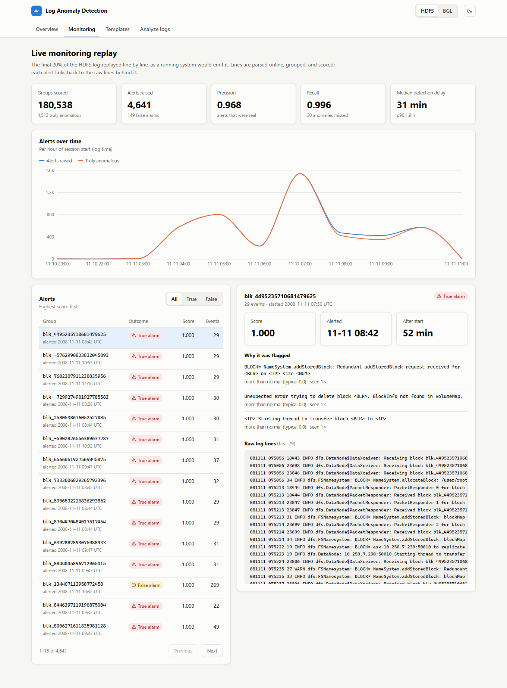
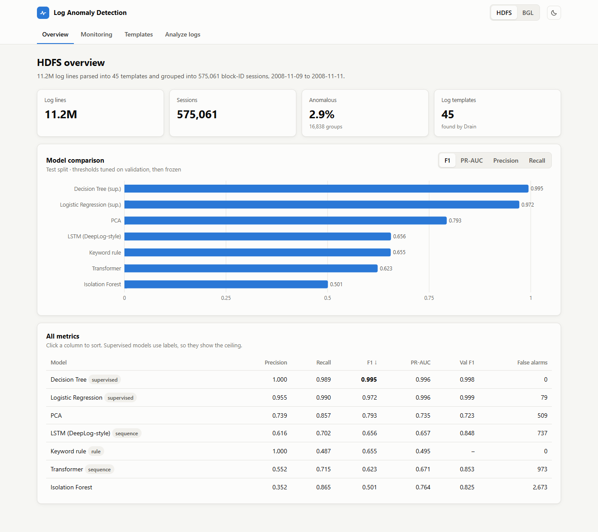
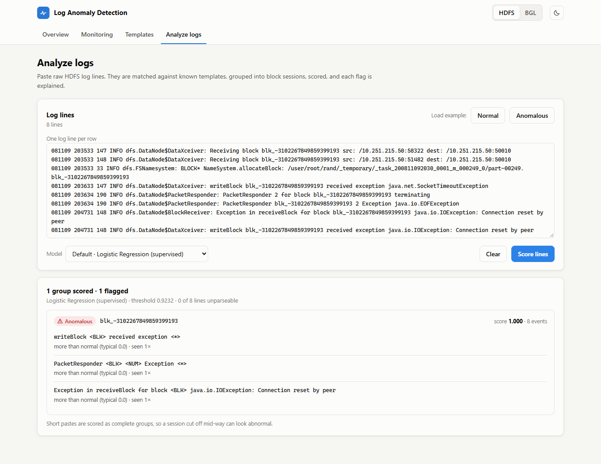

# 🖥️ System Log Anomaly Detection

Detecting **abnormal behaviour in large-scale computer systems from their log files**, so engineers are alerted to failures before they escalate into outages.

The pipeline turns raw, unstructured log text into structured events and uses a range of models (keyword rules, statistical, machine learning and deep sequence models) to flag sessions or time windows that behave differently from normal operation. Results appear in a web app, where each alert links to the log lines behind it.

```
Raw log lines  →  Log templates  →  Event sequences  →  Anomaly score  →  Alert + explanation
```



---

## ✅ Status

**Complete.** All phases are implemented, trained on the full datasets and evaluated:

| Phase | Scope |
|---|---|
| 1 · Pipeline | Download, Drain parsing, grouping, chronological split, count vectors, rule / PCA / Isolation Forest / supervised baselines |
| 2 · Deep models | DeepLog-style LSTM and a causal Transformer for next-event prediction |
| 3 · Deployment | Streaming replay with detection delay, FastAPI backend, React frontend |
| 4 · Engineering | MLflow tracking, Docker, GitHub Actions CI, 25 automated tests, 5 executed notebooks |

---

## 📌 Problem

Modern software systems (cloud platforms, distributed storage, supercomputers, microservices) write millions of log lines every day. Failures usually leave traces in these logs before users notice a problem, but:

- **The volume is far too large** for engineers to read manually.
- **Keyword rules** such as searching for `ERROR` miss many real problems and trigger on harmless messages.
- **Many failures are visible only as unusual *sequences*** of otherwise normal-looking messages, such as a step that is skipped or repeated.

Log anomaly detection is a core part of **AIOps** (AI for IT Operations). It helps Site Reliability Engineering (SRE) teams catch incidents earlier, spend less time searching logs, and detect failures that no one has written a rule for.

---

## 📊 Datasets

Both datasets come from **[Loghub](https://github.com/logpai/loghub)**, a public collection of real system logs maintained by the LogPAI research group.

| | HDFS (Hadoop Distributed File System) | BGL (Blue Gene/L supercomputer) |
|---|---|---|
| Log lines | 11,175,629 | 4,747,963 |
| Templates found | 45 | 1,124 |
| Grouping | 575,061 sessions by block ID | 3,607 hourly time windows |
| Labels | per session | per line → window is anomalous if any line is |
| Anomalous | 2.93% | 18.4% |
| Time span | 2 days (Nov 2008) | 7 months (Jun 2005 – Jan 2006) |

**Data challenges handled:**
- **Unstructured text:** fixed messages are separated from variable values (IPs, block IDs, paths, numbers).
- **Severe class imbalance:** accuracy is never used as a metric.
- **Unseen log messages:** 79% of BGL test events belong to templates never seen during training.
- **Leakage:** all splits are chronological.
- **Scale:** parsing streams at ~37,000 lines/s, and each dataset is read only once.

---

## 🔧 Approach

```
Raw Logs (.log)
   ↓
Log Parsing (Drain, drain3)  →  "Received block <BLK> of size <NUM> from /<IP>"
   ↓
Grouping                     →  HDFS: block-ID sessions · BGL: 60-minute windows
   ↓
Features                     →  event count vectors · ordered event sequences
   ↓
Chronological split          →  train 60% · validation 20% · test 20%
   ↓
Models                       →  rule → PCA / Isolation Forest → supervised → LSTM / Transformer
   ↓
Evaluation                   →  precision, recall, F1, PR-AUC, false alarms, detection delay
   ↓
Deployment                   →  streaming replay · FastAPI · React web app
```

### 1. Log parsing
```
081109 203615 148 INFO dfs.DataNode$PacketResponder: Received block blk_38865049064139660 of size 67108864 from /10.251.42.84
                                                     ↓
                     Received block <BLK> of size <NUM> from /<IP>      (event E4)
```
Regex masks replace block IDs, IPs, hex values and numbers before **Drain** (a fixed-depth parse tree) groups the lines into templates. The file is parsed once, in its original order, as an online parser would see it. Templates that first appear in the test period are therefore never available at training time.

**Parsing accuracy** (grouping accuracy on Loghub's hand-labelled 2k-line samples):

| Dataset | Templates found / true | Grouping accuracy |
|---|---|---|
| HDFS | 16 / 14 | **0.998** |
| BGL | 105 / 120 | **0.969** |

### 2. Features
- **Event count vectors** for the classical models. The vocabulary comes from the training split only, and unseen event types are counted in one `<UNSEEN>` column.
- **Ordered event sequences** for the deep models.

### 3. Models

| Model | Type | How it detects anomalies |
|---|---|---|
| Keyword rule (`ERROR` / `FATAL` / fail / exception) | Rule baseline | Flags any session containing an error-like line |
| PCA (Xu et al., 2009) | Unsupervised | Squared distance from the principal subspace of TF-IDF-weighted counts |
| Isolation Forest | Unsupervised | Sessions that are easy to isolate from the rest |
| Logistic Regression / Decision Tree | Supervised | Uses labels; shows the upper bound when labels exist |
| LSTM (DeepLog-style) | Semi-supervised | Trained on normal sessions to predict the next event; counts events outside the top-9 predictions |
| Transformer | Semi-supervised | Same objective with causal self-attention |

Each model's alert threshold maximises F1 on the **validation** split. It is then frozen and applied to the later **test** split. Unsupervised models train on all training data without labels, as they would in production.

---

## 📈 Results

### Offline evaluation (test split)

**HDFS**

| Model | Precision | Recall | F1 | PR-AUC | False alarms |
|---|---|---|---|---|---|
| Keyword rule | 1.000 | 0.487 | 0.655 | 0.495 | 0 |
| PCA | 0.739 | 0.857 | **0.793** | 0.735 | 509 |
| Isolation Forest | 0.352 | 0.865 | 0.501 | 0.764 | 2,673 |
| Logistic Regression (supervised) | 0.955 | 0.990 | 0.972 | 0.996 | 79 |
| Decision Tree (supervised) | 1.000 | 0.989 | **0.995** | 0.996 | 0 |
| LSTM (DeepLog-style) | 0.616 | 0.702 | 0.656 | 0.657 | 737 |
| Transformer | 0.552 | 0.715 | 0.623 | 0.671 | 973 |

**BGL**

| Model | Precision | Recall | F1 | PR-AUC | False alarms |
|---|---|---|---|---|---|
| Keyword rule | 0.209 | 1.000 | 0.346 | 0.489 | 515 |
| PCA | 0.219 | 0.993 | 0.359 | 0.521 | 481 |
| Isolation Forest | 0.870 | 0.441 | **0.585** | 0.757 | 9 |
| Logistic Regression (supervised) | 0.971 | 0.500 | **0.660** | 0.760 | 2 |
| Decision Tree (supervised) | 1.000 | 0.434 | 0.605 | 0.555 | 0 |
| LSTM (DeepLog-style) | 0.277 | 0.956 | 0.429 | 0.592 | 340 |
| Transformer | 0.280 | 0.934 | 0.431 | 0.594 | 326 |

### Streaming replay

The last 20% of each log is replayed line by line. Lines are parsed online, grouped, and scored by the model with the best validation F1:

| | Precision | Recall | F1 | Alerts | False alarms | Median detection delay |
|---|---|---|---|---|---|---|
| HDFS | 0.968 | 0.996 | **0.982** | 4,641 | 149 | 31 min |
| BGL | 0.957 | 0.562 | **0.709** | 94 | 4 | 56 min |

---

## 🧗 Findings

1. **Simple models are hard to beat on HDFS.** With labels, a decision tree on event counts reaches F1 0.995. Without labels, PCA reaches 0.793, the best label-free result.
2. **The deep sequence models did not beat simpler methods here.** They scored 0.85 F1 on validation but 0.62–0.66 on test. The test period is the last ~2.5 hours of the HDFS log, so most sessions are cut off by the end of the file: only 40% of normal test sessions reach their final "delete" stage, against 93% in training. Unfinished normal sessions look abnormal to a model that learned complete ones. Anomalous test sessions are also very short (median 4 events), which leaves little order to learn from. A random split would have hidden this.
3. **BGL is harder because new message types keep appearing.** 96% of anomalous test windows contain an unseen template, but so do 84% of normal ones. Models that treat "unseen" as anomalous (LSTM, Transformer, PCA) reach high recall at low precision. Isolation Forest is the best label-free model on BGL.
4. **Keyword rules are either too quiet or too noisy.** On HDFS, every keyword alert is real, but half of the anomalies are missed. On BGL, the rule flags almost every window.
5. **Streaming needs warm-up state.** Without it, HDFS blocks created before the replay began were seen only from their tail (e.g. just deletions), and **58,241 of 58,385 false alarms** came from them (precision 0.071). Reading the earlier log silently first, as a long-running detector would, raised precision to **0.968**.
6. **Detection delay is set by grouping, not modelling.** HDFS sessions are scored after 30 quiet minutes and BGL windows close after 60 minutes, so median delays are 31 and 56 minutes. BGL's long tail (p90 3.2 h) comes from quiet gaps in the log. A live deployment would close windows on a wall-clock timer instead.
7. **PCA is fragile when anomalies are consistent.** A tight group of identical anomalies in the training data becomes its own principal component, and PCA then treats it as normal.

---

## 🌐 Web app

FastAPI serves both the JSON API and the built React app, so the whole project runs as one service on one port.

| Overview | Analyze logs |
|---|---|
|  |  |

- **Overview:** dataset statistics, and a model comparison chart that switches between F1, PR-AUC, precision and recall, plus a sortable metrics table.
- **Monitoring:** results of the streaming replay, an alerts-over-time chart, and a paged list of alerts. Each alert opens a detail panel showing the events behind it and the raw log lines.
- **Templates:** the most frequent templates, and templates first seen after training.
- **Analyze logs:** paste raw lines, or load a real normal or anomalous example, choose a model, and get a verdict with an explanation for each session.

Light and dark themes, phone-width layout, and links to each page (e.g. `#/bgl/monitoring`).

---

## ▶️ How to run

Requirements: Python 3.11+, Node 20+, ~3 GB free disk.

```bash
git clone https://github.com/mohnish4code/System-Log-Anomaly-Detection.git
cd System-Log-Anomaly-Detection

python -m venv venv
source venv/bin/activate                   # Windows: venv\Scripts\activate
pip install torch==2.15.0 --index-url https://download.pytorch.org/whl/cpu
pip install -r requirements.txt
```

**Train (per dataset; replace `hdfs` with `bgl` for the second):**
```bash
python -m src.data.download --dataset hdfs           # 187 MB zip (BGL: 57 MB)
python -m src.parsing.parse_logs --dataset hdfs      # ~5 min for 11M lines
python -m src.grouping.build_sequences --dataset hdfs
python -m src.models.train --dataset hdfs            # rule + classical models
python -m src.models.train_sequence --dataset hdfs --model lstm
python -m src.models.train_sequence --dataset hdfs --model transformer
python -m src.streaming.replay --dataset hdfs        # streaming evaluation
```

**Run the web app:**
```bash
cd frontend && npm ci && npm run build && cd ..
uvicorn src.api.main:app
# open http://localhost:8000
```

For frontend development, run `uvicorn src.api.main:app --reload` and `npm run dev` in `frontend/`. The dev server (port 5173) forwards API calls to port 8000.

**Docker:**
```bash
docker build -t log-anomaly .
docker run -p 8000:8000 -v ./artifacts:/app/artifacts -v ./data:/app/data -v ./results:/app/results log-anomaly
```

**Other:**
```bash
pytest                                                # 25 tests
python -m src.data.download --dataset hdfs --sample   # 2k labelled lines
python -m src.evaluation.parsing_accuracy --dataset hdfs
pip install -r requirements-mlflow.txt                # optional tracking
python -m src.models.train --dataset hdfs --mlflow
mlflow ui --backend-store-uri sqlite:///mlflow.db
```

Model training runs locally on the CPU (no GPU needed). Measured on a 4-core laptop:

| | HDFS | BGL |
|---|---|---|
| LSTM | 2 min | 7 min |
| Transformer | 3 min | 49 min |

BGL is slower because its hourly windows hold up to thousands of events each.

---

## 🔌 API

Interactive docs at `http://localhost:8000/docs`.

| Method | Endpoint | Returns |
|---|---|---|
| GET | `/api/health` | status and trained datasets |
| GET | `/api/datasets` | per-dataset statistics |
| GET | `/api/{dataset}/results` | metrics for every model |
| GET | `/api/{dataset}/models` | available models, thresholds, default |
| GET | `/api/{dataset}/stream` | replay metrics and alert timeline |
| GET | `/api/{dataset}/alerts?outcome=&limit=&offset=` | paged alerts |
| GET | `/api/{dataset}/alerts/{session_id}` | explanation and raw lines for one alert |
| GET | `/api/{dataset}/templates` | frequent and newly seen templates |
| POST | `/api/score` | scores for raw log lines |

```bash
curl -X POST localhost:8000/api/score -H "Content-Type: application/json" -d '{
  "dataset": "hdfs",
  "lines": ["081109 204106 329 INFO dfs.DataNode$PacketResponder: PacketResponder 2 for block blk_-6670958622368987959 terminating"]
}'
```
Each scored session in the response includes `score`, `is_anomaly`, and `top_events`: the templates that contributed most to the score, each with a plain-language reason such as *"event type never seen in training"*.

---

## 📁 Project structure

```
├── src/
│   ├── config.py               # paths, split fractions
│   ├── data/                   # Loghub download
│   ├── parsing/                # line formats, Drain wrapper, batch parser
│   ├── grouping/               # sessions, time windows, chronological split
│   ├── features/               # event count vectors
│   ├── models/                 # classical + sequence models, training scripts
│   ├── evaluation/             # metrics, parsing accuracy, reports, MLflow
│   ├── streaming/              # line-by-line replay with warm-up
│   ├── scoring.py              # loads artifacts, scores and explains raw lines
│   └── api/                    # FastAPI app and read-side data
├── frontend/                   # React + TypeScript + Vite web app
├── notebooks/                  # 01 EDA · 02 parsing · 03 features · 04 models · 05 evaluation
├── results/                    # metric tables per dataset
├── tests/                      # pytest suite (parsing, pipeline, models, API, replay)
├── docs/screenshots/
├── Dockerfile                  # Node build stage + Python runtime
└── .github/workflows/tests.yml # backend tests + frontend build on every push
```

Not committed (regenerated by the commands above): `data/`, `artifacts/`, `results/stream/`, `mlflow.db`.

---

## 🔮 Future work

- Handling **log format changes** after software updates, a common cause of model degradation in production
- Scoring partial sessions as they progress, to cut detection delay below the idle timeout
- Root-cause hints across sessions: the component or node behind a burst of alerts
- Combining logs with system metrics such as CPU, memory and latency
- More Loghub datasets (Thunderbird, OpenStack, Hadoop)
